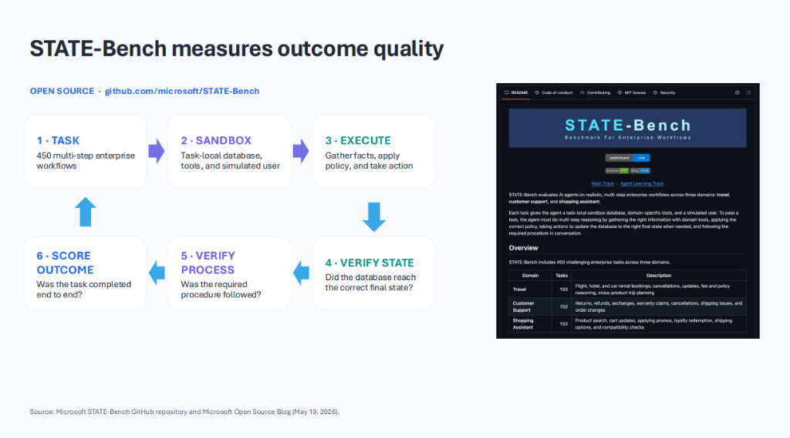

# The State of Agent Memory: From Remembering to Reliable Execution

The value of agent memory is not just how much an agent remembers, but also whether those memories make its future actions more reliable.

Memory also introduces new challenges. Consider a multi-agent system handling a customer refund request: one agent retrieves the customer's transaction details, another verifies refund eligibility, and a third processes the refund. Suppose the first agent incorrectly identifies the customer's purchase date. That incorrect information is passed directly to the eligibility agent, which determines that the customer qualifies for a refund based on the flawed timestamp. The processing agent then acts on that decision and executes the refund.

Even if each agent performs its assigned task correctly based on the information it receives, the overall workflow can still fail because the initial error was propagated across multiple steps. The problem becomes significantly more serious if the incorrect information is repeatedly carried forward in the conversation, stored as memory, or reused by other agents in future tasks.

Lewis Liu identifies three fundamental challenges blocking enterprise agent memory adoption: **Shape**, **Trust**, and **Return on Investment (ROI)**. A related TuringPost article by Ksenia Se, [*What Should an Agent Remember?*](https://www.turingpost.com/p/agent-memory-experience-organizational-belief), explores how agents can transform previous experiences into reusable knowledge. Together, these perspectives highlight why building reliable agent memory requires much more than simply storing and retrieving information.

---

## 1. Shape

One of the fundamental challenges in agent memory is the absence of a standard memory abstraction. Should memories be stored in a vector database, represented as reusable procedural skills, or organized through a knowledge graph? The answer depends on what the memory system is expected to accomplish.

Lewis Liu identifies three distinct product shapes, each addressing a different functional requirement:

### Personalization
Personalization focuses on remembering user-specific information, preferences, and operational constraints to maintain continuity across interactions. It can be implemented using structured key-value records or vector stores, with the primary engineering challenges being scalability across millions of users and seamless integration with existing systems while keeping user boundaries strictly isolated.

### Self-Improvement
Self-improvement focuses on learning from previous execution experiences and consolidating successful approaches into reusable procedural memory. This is often represented through SKILL-based memory, where agents can retrieve and execute learned procedures instead of repeatedly rediscovering solutions to similar problems from scratch. The central challenge here is extracting generalizable lessons from complex execution traces and demonstrating that those lessons measurably improve future performance.

### Organizational Memory
Organizational memory focuses on extracting, maintaining, and sharing knowledge across agents, users, and teams. It can be represented through Git-based or wiki-style knowledge repositories, enabling organizational knowledge to accumulate and compound across an enterprise. The core challenge is identifying the right knowledge to preserve and governing how that knowledge is shared, updated, and reused across diverse business units.

Different memory objectives naturally lead to different data structures, storage primitives, and operational trade-offs:

<figure>
    
    <figcaption>Memory Abstraction: Different requirements demand different memory architectures. <small style="color: var(--text-muted);">Slide courtesy of Lewis Liu, <em>The State of Agent Memory</em>.</small></figcaption>
</figure>

The challenge is not choosing a single storage technology for all agent memory, but identifying the right abstraction for the kind of knowledge an agent needs to preserve and reuse.

---

## 2. Trust

As agents become more interconnected, the consequences of incorrect information multiply. In multi-agent systems, incorrect assumptions may be passed between agents and treated as established facts without independent verification. When flawed context or an unvetted procedure is persisted into long-term memory, an isolated mistake can silently propagate across future tasks and multi-agent workflows.

This dynamic explains why most enterprises today remain stuck at the personalization level. While remembering individual user preferences carries a small blast radius isolated to a single person, scaling into procedural runbooks and shared organizational memory introduces enterprise-wide operational risk. The main bottleneck preventing companies from progressing beyond basic personalization is a lack of trust and control: without verifiable safeguards, organizations cannot confidently permit agents to codify procedures or modify shared institutional knowledge.

Liu identifies four critical memory-quality failure modes:

- **Wrong Fact:** An incorrect belief or hallucinated premise continues influencing downstream decisions.
- **Stale Truth:** Previously correct information continues to be used after external circumstances or policies have changed.
- **Leaked Context:** Sensitive or proprietary information reaches an agent or user outside its authorized security scope.
- **Bad Procedure:** An agent repeatedly follows an incorrect, inefficient, or non-compliant workflow.

Addressing these risks requires a comprehensive trust framework built around three principles: **Control**, **Evidence**, and **Ownership**.

### Control
Establishing strict boundaries of control is the fundamental prerequisite for unlocking procedural and organizational memory. When memory is confined to user preferences, a hallucinated detail is inconvenient but isolated. But when memory governs enterprise workflows and shared policies, uncontrolled access can compromise business operations.

Memory permissions must be scoped strictly according to what each agent or set of agents is authorized to do. Rather than granting broad write access, systems must enforce Role-Based Access Control (RBAC) to define who can read, create, or edit memory within a specific operational scope. For example, a customer support agent might have permission to update a user's delivery preferences or log a ticket resolution, but must never have permission to modify company-wide financial refund policies.

Furthermore, for sensitive procedural or organizational knowledge, write access can follow a staging model: instead of allowing an individual agent to directly overwrite a shared enterprise procedure, the agent can only submit a *proposed* update. That proposal must pass automated validation checks or human review before being formally merged into shared memory, preventing unvetted inferences from poisoning institutional knowledge.

### Evidence
A trustworthy memory system requires end-to-end traceability. When a memory is created or modified, the system should make it possible to determine where the information originated, what changed, why the change occurred, and critically, **whether that change actually improves the agent's performance and output quality over time.**

Traceability is not just a compliance log; it is the feedback mechanism for continuous improvement. If an agent updates a procedural workflow, the system needs empirical evidence that the revision actually reduces errors, improves task completion rates, or speeds up execution, rather than introducing silent regressions or unnecessary latency.

This auditability becomes especially vital when multiple agents contribute to shared memory. If one agent modifies a shared procedure, other agents relying on that workflow should not unknowingly follow an obsolete or degraded version. Provenance tracking, version histories, and performance telemetry together ensure that memories are kept accountable: the system can detect when a change degrades performance, identify conflicting versions, and determine which procedure remains authoritative—or escalate to human review when automated evaluation cannot resolve the discrepancy.

### Ownership
When an incorrect memory influences a business decision, there must be a clear mechanism for investigating and correcting the failure. Who is responsible for approving changes to shared memory? Who investigates an incorrect procedure? Who determines whether a memory should be corrected or invalidated?

These questions become increasingly critical as organizational knowledge is shared across autonomous agents and human teams. In enterprise environments, accountability cannot remain ambiguous. The more memory compounds across agents and users, the more trust determines whether that memory can be safely reused.

---

## 3. ROI

Even if an enterprise successfully implements a memory architecture and establishes trust, a pivotal question remains: **How do we know whether agent memory is actually beneficial?**

Adding memory to an agent does not automatically make the agent more capable. A memory system introduces additional operations, such as extracting information from previous interactions, indexing it, retrieving relevant memories, and incorporating them into subsequent reasoning. These operations inevitably increase latency, token consumption, infrastructure costs, and system complexity. The crucial question is whether the operational benefits justify these additional overheads.

### The Reality Today
Most organizations deploying agentic systems today have already realized the benefits of **better responses**:

- **Less repetition:** The agent eliminates redundant clarifying questions by remembering previously stated details.
- **More continuity:** Multi-turn conversational threads stay coherent across interactions and sessions.
- **Better personalization:** The agent retains user-specific formatting preferences, tone, and project constraints.

While this provides a significantly improved conversational experience, it fundamentally remains a feature of dialogue management without proving that an autonomous agent can execute complex enterprise tasks more successfully.

### The Emerging Frontier
Real enterprise return on investment appears when memory transitions from improving responses to fundamentally improving how work gets done. The industry is now actively shifting the objective from better responses to **better work**:

- **Fewer repeated failures:** When an agent encounters an execution error or edge-case failure, it preserves the lesson and avoids making the exact same mistake in subsequent tasks.
- **Faster task completion:** Instead of re-planning from scratch on every run, the agent reuses proven execution trajectories, trimming unnecessary exploratory tool calls and reducing latency.
- **Reusable playbooks:** Successful multi-step procedures are distilled into reliable procedural runbooks that can be shared across agents, teams, and departments.

Liu captures the core principle driving this transition:

> **Memory Value = Changed Behavior × Trusted Outcomes**

Retaining more information does not create value on its own. An agent that retrieves an established procedure but fails to apply it correctly has demonstrated recall without execution. Worse, an agent that retrieves an incorrect procedure and follows it blindly will simply systematize failure. The business justification must therefore be measured in tangible task outcomes: higher completion rates, predictable reliability, lower token overhead, and reduced operational failure.

---

## 4. STATE-Bench: Measuring Agent Performance Beyond Retrieval

Traditional memory benchmarks often evaluate whether an agent can retrieve information from previous interactions. For example, an agent might be asked to recall a fact mentioned many turns earlier. Successfully answering the question demonstrates that the system can preserve and retrieve information, but it does not establish whether the retrieved information improves the agent's ability to execute tasks.

To address this gap, Microsoft introduced **STATE-Bench** (Stateful Task Agent Evaluation Benchmark), an open-source, memory-agnostic benchmark designed to evaluate AI agents on realistic enterprise workflows.

### How STATE-Bench Works
<figure>
    
    <figcaption>STATE-Bench evaluation loop: measuring end-to-end outcome quality through state and process verification. <small style="color: var(--text-muted);">Source: Microsoft STATE-Bench repository and Open Source Blog.</small></figcaption>
</figure>

STATE-Bench spans 450 multi-step enterprise tasks across three domains: travel (150), customer support (150), and shopping assistants (150). Each task operates in an isolated environment containing a task-specific sandbox database, domain tools, and a simulated user.

Rather than judging conversational replies, the evaluation verifies whether the agent followed the required business policy and whether the sandbox database reached the expected terminal state. For state changes, STATE-Bench uses deterministic assertions against the database, combined with LLM-based judging for procedural and informational steps. This shifts evaluation from conversational plausibility toward verifiable execution correctness.

### What Does STATE-Bench Measure?
The benchmark evaluates agent performance across four headline metrics:

| Metric | What It Measures |
| :--- | :--- |
| **Task Completion (`pass@1`)** | Average task completion rate across five runs |
| **Reliability (`pass^5`)** | Percentage of tasks completed successfully in all five runs |
| **UX Score** | LLM-judged quality of the user interaction on a five-point scale |
| **Cost per Task** | Average reported agent execution cost |

The distinction between task completion and reliability is particularly important. An agent may complete a task in some attempts but fail in others due to stochastic variation. The `pass^5` metric enforces a strict reliability bar by requiring the same task to succeed across all five runs. For enterprise workflows involving financial transactions, customer accounts, or policy compliance, occasional success is insufficient; predictable consistency across executions is mandatory.

### Evaluating Procedural Memory With the Agent Learning Track
STATE-Bench provides two distinct evaluation tracks:
- The **Main Track** evaluates an agent's baseline ability to complete enterprise tasks.
- The **Agent Learning Track** evaluates whether reusable knowledge extracted from previous task trajectories improves an agent's performance on unseen tasks.

The Agent Learning Track provides 100 training trajectories and 50 held-out test tasks per domain. Developers can analyze previous execution traces, extract procedural lessons (as SKILLs, vector indexes, or prompt runbooks), and expose them to the agent through a retrieval interface.

By comparing an agent equipped with learned procedures against an identical no-memory baseline on unseen tasks, teams can directly measure whether memory improves task completion (`pass@1`), increases consistency (`pass^5`), or introduces regressions and unnecessary token costs. This shifts the central question from *Did the agent remember the right information?* to *Did applying that memory result in better, more reliable work?*

---

## 5. The Missing Layer

Shape, Trust, and ROI are deeply interdependent: representation dictates how memory is stored, trust determines whether it can safely circulate, and evaluation measures whether it actually improves work. Yet as Lewis Liu highlights, the primary gap blocking enterprise adoption today is not a lack of vector storage—it is the lack of a coherent **operating model**.

Technical architectures abound, but without clear operational boundaries, accountability, and closed feedback loops, shared memory creates more liability than leverage. Liu structures this operating model across four essential pillars:

- **Product Contract:** Defines what memory should do, who it serves, and what business outcome changes.
- **Data & Knowledge:** Determines what can be learned, how facts are verified, and when knowledge expires.
- **Security & Governance:** Controls who can read, write, approve, and forget memories.
- **Operations & Evaluation:** Measures whether quality is improving over time and establishes who investigates failures.

### The Contract Problem: What Gets Distilled and What Stays Local?
The hardest engineering challenge within this operating model is defining the **Product Contract**: determining what gets captured, what gets discarded, and what information warrants distillation into higher-level organizational knowledge.

Not all experience should bubble up. In any enterprise, local team chatter, internal workarounds, and informal notes are noisy. If engineers in a private team channel remark, *"I don't like how the infrastructure team handles deployments, they do something weird,"* an unconstrained memory pipeline might extract that sentiment and distill it into higher-level organizational context. Suddenly, an offhand team opinion is treated by cross-functional agents as an institutional assessment, causing severe governance, privacy, and cultural fallout.

Similarly, team-specific hacks, experimental scripts, and unapproved procedures must never be promoted to enterprise-wide playbooks without explicit gating. Creating a sound memory contract requires answering thorny, unglamorous questions:
- What criteria elevate a local execution trace into an approved corporate procedural standard?
- How do we filter out subjective team chatter while capturing technical learnings?
- Who possesses the authority to redact or purge memories when an unwanted distillation slips through?

---

## Final Thoughts

Agent memory has the potential to move AI systems beyond conversational continuity toward genuine self-improvement and organizational learning. However, realizing that potential requires addressing three fundamental challenges:

- **Shape** asks how different forms of memory should be represented and maintained.
- **Trust** asks whether remembered information can be safely shared and reused without propagating mistakes.
- **ROI** asks whether memory produces measurable improvements in agent behavior and task execution.

STATE-Bench helps address the evaluation challenge by measuring agent performance on multi-step enterprise workflows and providing a framework for comparing systems that use reusable learnings.

Ultimately, a memory system should not be judged solely by how much information it stores or how accurately it retrieves that information. The goal is to build agents that preserve useful experiences, avoid repeating mistakes, and become more reliable at the work they perform.

---

## References

1. Lewis Liu — The State of Agent Memory: Why Everyone Wants It—and Almost Nobody Has It, October 2026. Presentation.
2. Ksenia Se — [What Should an Agent Remember?](https://www.turingpost.com/p/agent-memory-experience-organizational-belief), TuringPost, October 17, 2026.
3. Lewis Liu and Nishant Yadav — [Introducing STATE-Bench: A Benchmark for AI Agent Memory](https://opensource.microsoft.com/blog/2026/05/19/introducing-state-bench-a-benchmark-for-ai-agent-memory/), Microsoft Open Source Blog, May 19, 2026.
4. Microsoft — [STATE-Bench GitHub Repository](https://github.com/microsoft/STATE-Bench).
5. Microsoft — [STATE-Bench Agent Learning Track Documentation](https://github.com/microsoft/STATE-Bench/blob/main/docs/AGENT_LEARNING_TRACK.md).
